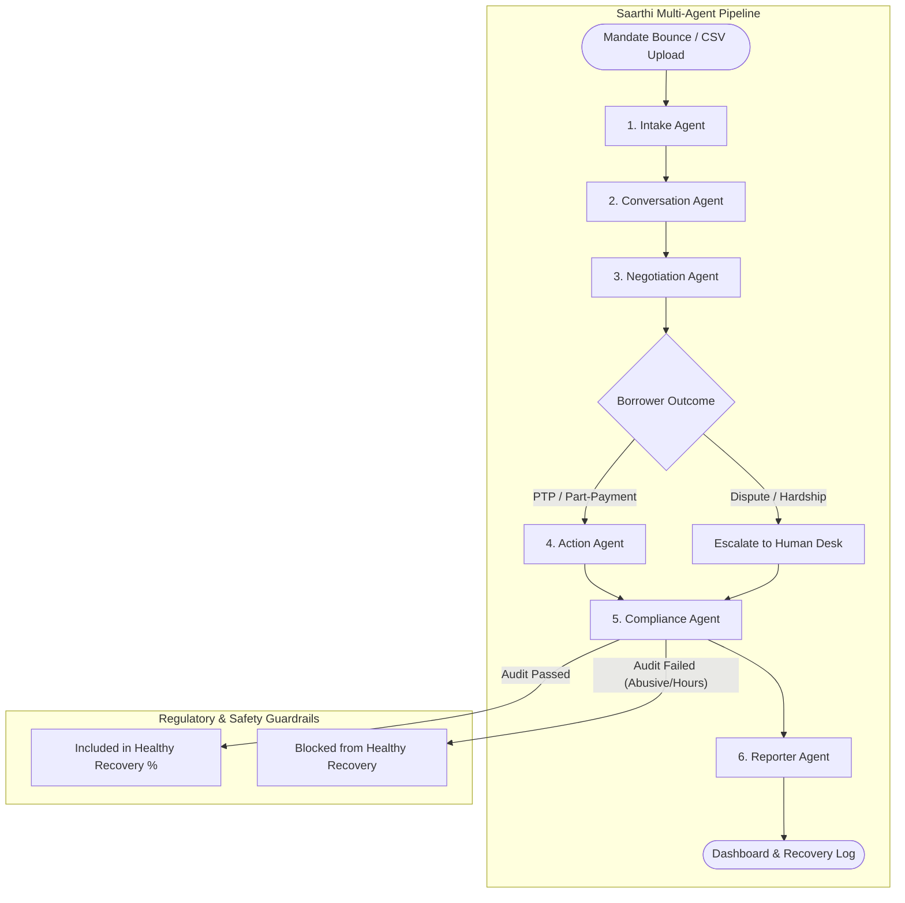

# Saarthi (सारथी) 🚀
### Autonomous AI Collections Teammate for Bharat Lenders

> **Track 3 · Autonomous AI Teammates**  
> Built on **Sarvam Indic AI Stack** (Sarvam-105B, Saaras, Bulbul) · Python 3.12 + FastAPI + SQLite + Tailwind CDN

---

## 1. Problem Statement & Verified Economics

In India, **26% to 38%** of retail EMI mandates bounce monthly (BCG / PayU data). 
- A human call-center case costs **₹52** on average.
- A physical field recovery visit costs **₹250 – ₹500** with zero guarantee of settlement.
- **Why Language Matters:** Indic language-matched collection calls increase borrower connection rates by **+34%** and extract **+28%** more payment commitments (Ravan.ai 2025).

**Saarthi** solves early delinquency (1–30 DPD) end-to-end:
1. **Detects Bounced EMI** → Reads account records and analyzes delinquency risk.
2. **Calls in Native Language** → Marathi, Hindi, English, Tamil.
3. **Mandatory RBI Consent** → Records consent before discussing debt.
4. **Negotiates Promise-to-Pay (PTP)** → Strict policy (PTP &le; 7 days, part payment &ge; 30%, no unauthorized waivers).
5. **Issues Idempotent UPI Payment Link** → Dispatches deep-link & WhatsApp notification during the call.
6. **Audits Itself for RBI Compliance** → Enforces 08:00–19:00 IST window, anti-coercion/anti-harassment check.
7. **Escalates the Hard Cases** → Disputes and genuine hardship route seamlessly to human officers with full transcript context.

---

## 2. Multi-Agent Architecture

Saarthi uses a **deterministic supervisor state machine** that coordinates 6 specialized agent functions over a single versioned case file:



### Agent Roster:
| Agent | Responsibility | Core Rules / Logic |
|---|---|---|
| **Supervisor** | Owns state machine | Intake &rarr; Conversation &rarr; Negotiation &rarr; Action &rarr; Compliance &rarr; Reporter. Max 3 retries, escalates on failure. |
| **Intake** | Account profiling | Computes delinquency bucket (1-30 DPD), risk note, tone hint, best call window. |
| **Conversation** | Call engine | Plays mandatory RBI consent line in Marathi/Hindi/English/Tamil. Captures objection/dialogue. |
| **Negotiation** | Lending policy enforcer | PTP &le; 7 days, part-payment &ge; 30%. Flags disputes ("already paid") and hardship ("lost job/waiver") for human escalation. |
| **Action** | Financial settlement rails | Generates idempotent UPI payment link (`upi://pay...`) and localized WhatsApp notification template. |
| **Compliance** | Regulatory watchdog | Audits 08:00–19:00 IST hours, consent verification, and scans for abusive/coercive language. Disqualifies bad calls. |
| **Reporter** | Macro portfolio analytics | Calculates actual cost/contact (e.g., ₹5.30 vs ₹52 industry baseline), PTP conversion %, and recovery %. |

---

## 3. Case File Schema (`CaseFile`)

Every agent reads from and appends typed records to one single source of truth:

```json
{
  "id": "1",
  "borrower_name": "Aniket Deshmukh",
  "phone": "+919820112233",
  "language": "Marathi",
  "amount_due": 40000.0,
  "due_date": "2026-11-16",
  "dpd": 3,
  "loan_id": "LN-MH-1001",
  "risk_note": "Low Risk (Early Stage) | DPD: 3 | Outstanding: ₹40,000.00",
  "tone_hint": "Friendly reminder, conversational and respectful",
  "best_call_window": "10:00 - 12:30 IST",
  "consent_played": true,
  "transcript": [
    {
      "speaker": "agent",
      "text": "नमस्कार अनिकेतजी, मी सारथी फायनान्शिअल कडून बोलत आहे. हा कॉल गुणवत्ता आणि अनुपालन तपासणीसाठी रेकॉर्ड केला जात आहे...",
      "ts": "14:12:17"
    },
    {
      "speaker": "borrower",
      "text": "माझा पगार दर महिन्याच्या 5 तारखेला खात्यात जमा होतो. मी 5 तारखेला नक्की सर्व थकीत रक्कम भरेन.",
      "ts": "14:12:17"
    }
  ],
  "intent": "ptp",
  "sentiment": "cooperative",
  "offer_made": "Full payment of ₹40,000.00 committed for 2026-11-22.",
  "ptp_date": "2026-11-22",
  "confidence": 0.94,
  "payment_link": "upi://pay?pa=saarthi.demolender@yesbank&pn=Demo+Lender+(Sample+Data)&am=40000.00&tr=c94b7e9b01a2&cu=INR",
  "payment_status": "sent",
  "audit_pass": true,
  "audit_reason": "PASSED: Full compliance verified (Calling hours IST, explicit consent, zero coercive language, valid PTP policy).",
  "status": "ptp",
  "assigned_human": null,
  "cost_inr": 5.30,
  "version": 7,
  "trace": [
    {"agent": "Intake", "action": "Account Profile Loaded", "ts": "14:12:03 UTC", "summary": "..."},
    {"agent": "Conversation", "action": "Voice Call Executed", "ts": "14:12:17 UTC", "summary": "..."},
    {"agent": "Negotiation", "action": "Policy Verification", "ts": "14:12:43 UTC", "summary": "..."},
    {"agent": "Action", "action": "UPI Payment Link Dispatched", "ts": "14:12:57 UTC", "summary": "..."},
    {"agent": "Compliance", "action": "Fair Practices Audit", "ts": "14:13:14 UTC", "summary": "..."},
    {"agent": "Reporter", "action": "Portfolio Synchronized", "ts": "14:13:29 UTC", "summary": "..."}
  ]
}
```

---

## 4. Key Demo Scenarios (Pre-scripted in Sample Book)

1. **Account #1 (Hero Demo · Marathi):**
   - Borrower Aniket Deshmukh owes ₹40,000 (DPD 3).
   - Explains salary arrives on the 5th. Agent negotiates PTP within 7-day window.
   - Generates UPI link and Marathi WhatsApp copy. Compliance turns **GREEN**.
2. **Account #2 (Dispute Escalation · Hindi):**
   - Borrower says *"अरे भाई, मैं तो 2 दिन पहले Google Pay से भर चुका हूँ!"*
   - Escalates immediately to Dispute Resolution Desk with bank statement audit log.
3. **Account #3 (Hardship Escalation · Marathi):**
   - Borrower lost job, asks for interest waiver / restructuring.
   - Lending policy strictly forbids automated waivers &rarr; escalated to Credit Committee.
4. **Account #4 (Abusive Agent Audit Test · Compliance Failure):**
   - Rogue transcript contains coercive threat: *"घर पर पुलिस और गुंडे भेजकर पूरे मोहल्ले में बेइज्जत करवाऊंगा!"*
   - Compliance Agent flags **CRITICAL VIOLATION**, turns **RED**, and disqualifies call from healthy recovery.

---

## 5. Local Setup & Execution

### Prerequisites
- Python 3.11+
- Virtual environment (recommended)

### Installation
```bash
git clone https://github.com/your-username/saarthi.git
cd saarthi
pip install -r requirements.txt
```

### Configure Environment
Create a `.env` file:
```ini
SARVAM_API_KEY=your_key_here
SIMULATE=true
DEMO_OVERRIDE_HOURS=true
```
*Note: When `SIMULATE=true`, all 20 accounts run 100% free with rich cached dialogues without consuming credits.*

### Run Automated Test Suite
```bash
pytest tests/test_flow.py -v
```

### Start Web Server
```bash
uvicorn app.main:app --host 0.0.0.0 --port 8000 --reload
```
- Open Dashboard: [http://localhost:8000](http://localhost:8000)
- Open Landing & Pitch Page: [http://localhost:8000/landing](http://localhost:8000/landing)

---

## 6. Unit Economics & Pricing

| Model | Price | Why a Bharat Lender Chooses Saarthi |
|---|---|---|
| **Free Pilot** | ₹0 | First 1,000 accounts processed free |
| **Per Connected Call** | ₹3 – ₹5 / min | Replaces ₹18–24 human outbound calls and ₹52 call-centre overhead |
| **Per Recovered Account** | ₹75 – ₹150 success fee | Replaces ₹1,400–1,800 third-party agency collection commissions |
